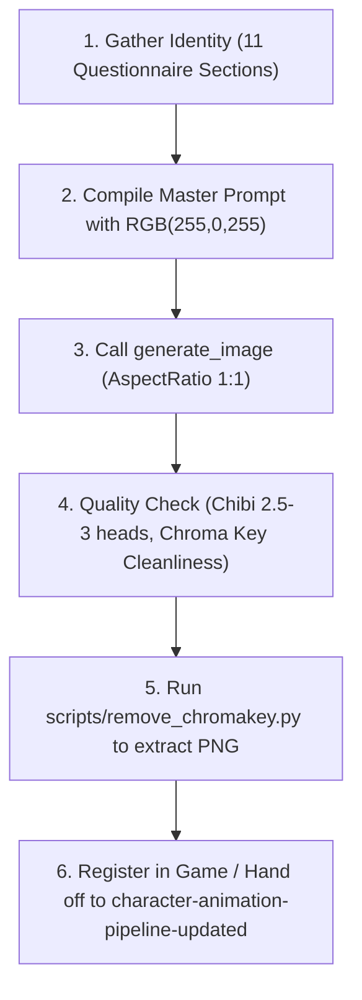

# Character Pipeline Skill

## 1. Overview and Purpose

This skill defines the standardized pipeline for conceiving, prompting, generating, validating, and extracting new character concept portraits and front-facing sprites for the game.

### Key Goals
- **Structured Character Creation**: Collects or derives character specifications across an 11-category identity questionnaire.
- **Strict Art Direction**: Enforces heroic chibi proportions (2.5–3 heads tall), battle-ready dark fantasy or sci-fi tone, 16-bit pixel-art aesthetics, and rigid negative constraints (no anime, no kawaii, no smiles).
- **Chroma Key RGB(255, 0, 255) `#FF00FF`**: Uses pure magenta background instead of white, allowing 100% reliable programmatic background removal and alpha channel transparency without clipping white eyes, bone, silver armor, or pale skin.
- **Upstream in the Character Pipeline**: Serves as the authoritative source concept for downstream assets (turnaround sheets, UI avatars, and the 6×4 sheets in `character-animation-pipeline-updated`).
- **Modifiable & Extensible**: Structured for easy customization as the game evolves.

---

## 2. Master Prompt Template

When synthesizing the final generation prompt for the `generate_image` tool, compile the character parameters into the following authoritative structure:

```text
128x128 chibi pixel art portrait of a [gender/species/type] [archetype/class], a [role/description].

Chibi proportions with an intentionally oversized head and compact body, [body type], [limb description], [stance], strong readable silhouette.

[Face/head description], [eye description], [expression details], no smile, no cute or adorable expression.

[Hair/head details], [optional mane/markings/ornaments].

[Clothing/armor/body description], [optional accessories].

[Held item: Holding a [weapon/tool/focus] with both hands, clearly visible beside the character / Holding no weapon, both hands raised in a ready combat stance], [optional offhand]. No other weapons.

[Optional magical/energy effects].

Pure solid magenta chromakey background rgb(255,0,255) #ff00ff, clean 16-bit pixel art game sprite, crisp hard pixel edges, limited color palette, strong contrast, chunky simplified forms, detailed equipment, clear readable silhouette.

Heroic [fantasy/dark fantasy/sci-fi] RPG game character design, battle-ready and dangerous despite chibi proportions.

No anime style, no kawaii style, no cute expression, no childish appearance, no soft pastel colors, [specific exclusions], no realistic proportions, no photorealism, no smooth gradients.

Additional character details to include: [list all extra details the user specifies].
```

---

## 3. The 11-Part Character Questionnaire

Before generating a character, the agent must either gather answers from the user or infer them from the user's high-level request.

### I. Базовая идентичность (Basic Identity)
1. **Пол, вид или тип персонажа?** (Gender, species, or creature type)
   * *Examples*: `male human`, `female elf`, `genderless skeleton`, `mechanical war-automaton`, `beast wolfman`, `dwarf berserker`
2. **Архетип или класс?** (Archetype or class)
   * *Examples*: `druid`, `warrior`, `mage`, `rogue`, `paladin`, `elementalist`, `necromancer`, `gunner`
3. **Роль или краткое описание?** (Role or brief summary)
   * *Examples*: `deadly nature guardian`, `undead cursed swordsman`, `heavy armored frontline shock trooper`

### II. Тело и поза (Body & Stance)
1. **Телосложение?** (Body build / type)
   * *Examples*: `athletic compact build`, `stocky heavy build`, `skeletal frame`, `bulky reinforced chassis`
2. **Конечности?** (Limb description)
   * *Examples*: `sturdy limbs with chunky iron boots`, `powerful armored gauntlets`, `exposed bleached bone limbs`, `sharp mechanical clawed digits`
3. **Поза?** (Combat stance)
   * *Examples*: `confident battle-ready stance`, `low aggressive predator stance`, `firm defensive grounded posture`
4. **Акцент на силуэте?** (Silhouette focus)
   * *Default*: `strong readable silhouette with wide shoulder profile and grounded chunky boots`

### III. Лицо и голова (Face & Head)
1. **Тип лица или головы?** (Face / head type)
   * *Examples*: `weathered human face`, `bare skull with cracked bone`, `faceless iron bucket helmet with narrow slit`, `feral wolf muzzle`, `sleek dark visor`
2. **Глаза?** (Eyes / ocular features)
   * *Examples*: `sharp piercing yellow eyes`, `glowing cyan eye sockets`, `monolithic red visor sensor slit`
3. **Выражение?** (Expression details)
   * *Examples*: `grim focused expression`, `determined stern look`, `cold intimidating stare`, `snarling with bared fangs`
   * *Rule*: `strictly no smile, no cute or adorable expression`
4. **Особые черты лица?** (Unique facial traits)
   * *Examples*: `jagged vertical scar across left eye`, `runic face paint`, `weathered leathery skin`

### IV. Волосы, голова, украшения (Hair, Headgear & Ornaments)
1. **Волосы или головной убор?** (Hair / beard / head covering)
   * *Examples*: `tied back raven black ponytail`, `thick braided iron-ringed beard`, `bare skull`, `dark velvet hood with frayed edges`
2. **Украшения или детали на голове?** (Head ornaments & markings)
   * *Examples*: `small twisted antler ornaments`, `horned brass helmet crest`, `glowing arcane runes tattooed on temples`

### V. Одежда, броня, тело (Clothing, Armor & Body)
1. **Одежда?** (Clothing / tunic / robes)
   * *Examples*: `tattered moss-green tunic`, `dark layered leather vest`, `torn hooded cloak draping behind`
2. **Броня?** (Armor pieces)
   * *Examples*: `forged dark iron breastplate with riveted shoulder pauldrons`, `carved bone ribcage armor`, `reinforced chainmail underneath`
3. **Цвета и материалы?** (Color palette & materials)
   * *Examples*: `charcoal dark iron, weathered bronze, moss green, deep earthy brown`
4. **Аксессуары?** (Pouches, talismans, buckles)
   * *Examples*: `dried herb pouches and bone charms on leather belt`, `heavy engraved iron belt buckle`
5. **Если без одежды?** (If creature / naked beast)
   * *Examples*: `no clothing, thick matted dark fur and armored chitinous plates`

### VI. Оружие или инструмент (Weapon / Held Item)
1. **Что персонаж держит?** (Main hand weapon / focus)
   * *Examples*: `gnarled oak staff tipped with glowing amber`, `heavy two-handed greatsword`, `twin rune daggers`, `no weapon`
2. **Как держит?** (Grip & posture)
   * *Examples*: `Holding a glowing runic staff with both hands, clearly visible beside the character`, `Holding no weapon, both hands raised in ready martial combat stance`
3. **Что во второй руке или на оффхенде?** (Offhand item)
   * *Examples*: `spiked buckler shield on left forearm`, `open hand crackling with spark`, `empty raised offhand`
4. **Отсутствие лишнего оружия?** (Weapon cleanliness)
   * *Mandatory rule*: `No other weapons, no floating floating secondary swords, no cluttered back sheath`

### VII. Магия и эффекты (Magic & Effects)
1. **Аура или свечение?** (Aura / glow)
   * *Examples*: `faint emerald magical wisps curling from weapon tip`, `subtle frosty mist at boots`, `no ambient magic`
2. **Частицы?** (Floating particles)
   * *Examples*: `sparse floating amber ember motes`, `subtle purple necrotic smoke wisps`
3. **Ядро или источник силы?** (Energy core / gem)
   * *Examples*: `glowing molten core visible behind ribcage`, `radiant soul crystal in chest`

### VIII. Стиль и палитра (Style, Palette & Background)
1. **Палитра?** (Palette properties)
   * *Rule*: `limited 16-bit color palette, strong shadow/highlight contrast, saturated accents, no soft pastel colors`
2. **Стиль спрайта?** (Sprite characteristics)
   * *Rule*: `clean 16-bit pixel art game sprite, crisp hard pixel edges, chunky simplified forms, detailed equipment`
3. **Фон?** (Background chroma key)
   * *Mandatory constraint*: `Pure solid magenta chromakey background rgb(255,0,255) #ff00ff`

### IX. Жанр и настроение (Genre & Mood)
1. **Жанр?** (Setting genre)
   * *Examples*: `dark fantasy`, `high fantasy`, `grim sci-fi / cyberpunk`, `post-apocalyptic`
2. **Общее настроение?** (Tone)
   * *Rule*: `Heroic RPG game character design, battle-ready, serious and dangerous despite chibi proportions`

### X. Негативные требования (Negative Constraints & Exclusions)
1. **Общий обязательный блок негативов**:
   * `No anime style, no kawaii style, no cute expression, no childish appearance, no soft pastel colors, no realistic proportions, no photorealism, no smooth gradients.`
2. **Специфические исключения под персонажа**:
   * *Examples*: `no flesh or skin on skeleton`, `no puppy eyes or cute dog face on werewolf`, `no modern sneakers`, `no angel wings`, `no elf ears`

### XI. Дополнительные детали (Additional Details)
1. **Уникальные акценты**:
   * *Examples*: `notched battle blade with blood groove, golden skull medallion pinned to chest, bandaged forearms`

---

## 4. Why Chroma Key RGB(255, 0, 255) `#FF00FF`?

Traditional white (`RGB: 255, 255, 255`) or black backgrounds cause severe issues in dark fantasy pixel art:
- White backgrounds accidentally erase white eyeball highlights, bone plates, silver swords, and white runes during keying.
- Black backgrounds destroy dark iron armor, charcoal leather, hair, and deep drop shadows.
- **Pure Magenta (`RGB: 255, 0, 255` / `#FF00FF`)**:
  - Is virtually non-existent in natural dark fantasy armor, leather, stone, and bone palettes.
  - Produces immediate, crisp thresholding with zero ambiguity.
  - Can be removed automatically via flood-fill from border pixels to preserve any accidental magenta gems or runes inside the character.

---

## 5. Execution Workflow

When a user asks to create a new character, follow this 5-step workflow:



### Step 1: Gather Parameters
If the user gave a partial description (e.g., *"Make an undead skeleton paladin with a glowing blue warhammer"*):
- Derive obvious answers to the 11 sections.
- If key artistic decisions are ambiguous, clarify using the chat or `ask_question`.
- Ensure all exclusions and positive traits match the dark fantasy heroic standard.

### Step 2: Compile the Generation Prompt
Assemble the string using the **Master Prompt Template** in Section 2:
- Ensure the background sentence reads:
  `Pure solid magenta chromakey background rgb(255,0,255) #ff00ff, clean 16-bit pixel art game sprite, crisp hard pixel edges...`
- Insert specific negative exclusions tailored to the character.

### Step 3: Call Image Generation Tool
Call `generate_image` with:
- `Prompt`: The compiled prompt.
- `ImageName`: `hero_<character_name>_concept` (lowercase with underscores, e.g. `hero_deathknight_concept`).
- `AspectRatio`: `'1:1'`

### Step 4: Verification Checklist
Check the generated image against these rules:
1. **Dimensions & Framing**: Character is centered, fully visible within the frame without cut-off feet or weapons.
2. **Proportions**: Chibi ratio is strictly 2.5–3 heads tall (large expressive head ~30-35%, compact sturdy body, chunky boots).
3. **Expression**: Cold, fierce, or grim. Zero kawaii or cute smile.
4. **Weapons**: Clear, readable silhouette. Only the specified weapon/hands present.
5. **Background**: Pure solid magenta `#FF00FF` with hard edges against the character sprite.

### Step 5: Background Removal
Run the included python script to convert the magenta chromakey to transparent alpha:

```powershell
python .agents/skills/character-pipeline/scripts/remove_chromakey.py `
  -i "<path_to_generated_image.png>" `
  -o "public/textures/heroes/hero_<name>_front.png" `
  -r 128
```

Options:
- `-i / --input`: Path to input image.
- `-o / --output`: Output file destination (e.g. `public/textures/heroes/hero_<name>_front.png`).
- `-t / --tolerance`: Distance tolerance in RGB space (default `20.0`).
- `--no-flood-fill`: Disable border flood-fill (default uses flood-fill so internal magenta accents stay safe).
- `-r / --resize`: Optional resize with nearest-neighbor interpolation to target size (e.g. `128` for 128x128 px).

---

## 6. Concrete Prompt Examples

### Example A: Undead Skeleton Knight (Dark Fantasy)
```text
128x128 chibi pixel art portrait of a genderless skeleton Death Knight, a cursed heavy armored undead vanguard.

Chibi proportions with an intentionally oversized head and compact body, skeletal frame with bulky armor, bone limbs with heavy iron greaves and gauntlets, confident battle-ready stance, strong readable silhouette.

Cracked aged skull, glowing ice-blue eye sockets, grim cold intimidating stare, no smile, no cute or adorable expression.

No hair, bare skull adorned with a rusted jagged iron crown, glowing frosted bone markings.

Tattered blackened tabard over rusted dark iron plate armor, chipped bone pauldrons on shoulders, heavy steel gorget.

Holding a massive jagged two-handed runic greatsword with both hands, clearly visible beside the character, frost wisps on the blade. No other weapons.

Subtle chilling frost mist particles around feet and sword tip, glowing blue soul fire in ribcage.

Pure solid magenta chromakey background rgb(255,0,255) #ff00ff, clean 16-bit pixel art game sprite, crisp hard pixel edges, limited color palette, strong contrast, chunky simplified forms, detailed equipment, clear readable silhouette.

Heroic dark fantasy RPG game character design, battle-ready and dangerous despite chibi proportions.

No anime style, no kawaii style, no cute expression, no childish appearance, no soft pastel colors, no flesh, no skin, no friendly skull, no realistic proportions, no photorealism, no smooth gradients.

Additional character details to include: jagged runes carved into iron armor, chipped blade edges, iron chain belt with hung skull trinket.
```

### Example B: Forest Beast Shaman / Druid (Wild Nature)
```text
128x128 chibi pixel art portrait of a male beastkin Druid Shaman, a deadly ancient forest guardian.

Chibi proportions with an intentionally oversized head and compact body, muscular stocky build, thick fur limbs with clawed leather gauntlets and chunky hide boots, low aggressive combat stance, strong readable silhouette.

Feral horned wolf face, sharp glowing amber eyes, snarling focused grim gaze with bared fangs, no smile, no cute or adorable expression.

Thick dark timber-wolf mane around neck, small twisted antler horns sprouting from temples, braided beard with iron rings.

Tattered moss-green tunic, reinforced cured brown leather shoulder armor, bronze bracers, runic herb pouches on hip belt.

Holding a gnarled oak staff topped with an emerald spirit crystal with both hands, clearly visible beside the character. No other weapons.

Faint magical emerald green aura wisps around staff crystal, floating spore particles.

Pure solid magenta chromakey background rgb(255,0,255) #ff00ff, clean 16-bit pixel art game sprite, crisp hard pixel edges, limited color palette, strong contrast, chunky simplified forms, detailed equipment, clear readable silhouette.

Heroic dark fantasy RPG game character design, battle-ready and dangerous despite chibi proportions.

No anime style, no kawaii style, no cute expression, no childish appearance, no soft pastel colors, no puppy face, no fluffy cartoon animal, no slender human body, no realistic proportions, no photorealism, no smooth gradients.

Additional character details to include: runic tattoos painted in pale clay on forearms, feather charms tied to staff horns.
```

### Example C: Tech Mech Paladin (Grim Sci-Fi)
```text
128x128 chibi pixel art portrait of a genderless combat automaton Tech Paladin, a heavy armored shock assault unit.

Chibi proportions with an intentionally oversized head and compact body, bulky armored industrial chassis, heavy hydraulic limbs with reinforced armored gauntlets and magnetic clamp boots, firm grounded combat stance, strong readable silhouette.

Reinforced blast helmet, glowing crimson horizontal sensor slit, stern menacing robotic glare, no smile, no cute or adorable expression.

No hair, crowned with angular communication antenna and reinforced cranial blast plates.

Heavy gunmetal grey ceramic armor plating with hazard orange trim, energy conduit cables running across chest and limbs.

Holding a heavy kinetic warhammer with both hands, clearly visible beside the character, energized copper coils on the hammer head. No other weapons.

Subtle electric spark particles on hammer head, glowing power reactor vent in torso center.

Pure solid magenta chromakey background rgb(255,0,255) #ff00ff, clean 16-bit pixel art game sprite, crisp hard pixel edges, limited color palette, strong contrast, chunky simplified forms, detailed equipment, clear readable silhouette.

Heroic sci-fi RPG game character design, battle-ready and dangerous despite chibi proportions.

No anime style, no kawaii style, no cute expression, no childish appearance, no soft pastel colors, no organic skin, no friendly robot eyes, no realistic proportions, no photorealism, no smooth gradients.

Additional character details to include: unit designation stencil "UNIT-07" on right pauldron, exhaust vent seams on shoulders.
```

---

## 7. Downstream Handover & Future Modifications

1. **Character Animation Production**:
   Once the concept portrait is approved and keyed out, pass the character design bible into `.agents/skills/character-animation-pipeline-updated/SKILL.md` to produce the three 6×4 sheets (`hero_<name>_idle.png`, `hero_<name>_walk.png`, `hero_<name>_attack.png`).
2. **Game Registration**:
   Follow `.agents/rules/entity-admin-sync.md` to register the new character in:
   - `game/src/balance/defaultBalance.ts`
   - `admin/src/constants.ts`
3. **Skill Modification Roadmap**:
   When updating this skill in future iterations:
   - Add new sub-archetypes or equipment variations in Section 3.
   - Expand the post-processing script (`scripts/remove_chromakey.py`) for automated batch turnaround slicing or UI avatar circle cropping.
