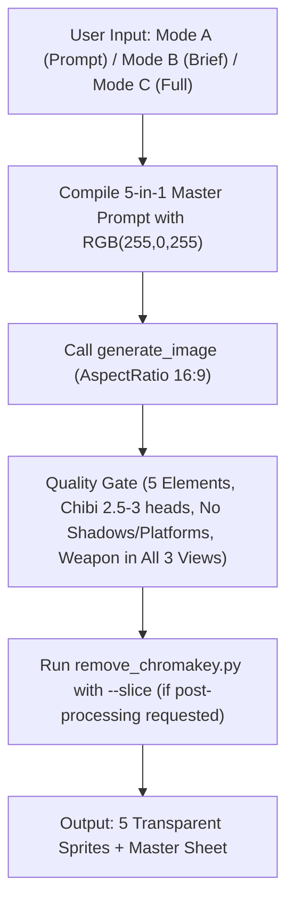

# Character Pipeline Skill (5-in-1 Model Sheet)

## 1. Overview and Purpose

This skill defines the standardized master pipeline for conceiving, prompting, generating, validating, and slicing **5-in-1 character model reference sheets** on a **single image**.

### The 5-in-1 Single Canvas Standard
Instead of generating individual unconnected assets, this pipeline renders **all 5 core character elements together on one 16:9 canvas**:
1. **PORTRAIT**: Close-up face/bust avatar for UI dialogs, HUD portraits, and character selection.
2. **FRONT VIEW**: Full-body character facing forward toward the camera in a battle-ready combat stance.
3. **BACK VIEW**: Full-body character facing directly away, displaying rear armor plates, cloak/cape drape, and back equipment.
4. **RIGHT PROFILE VIEW**: Full-body character in a strict right-facing profile view.
5. **WEAPON PREVIEW**: Isolated, enlarged/detailed display of the character's weapon, tool, or magical focus.

```text
+---------------------------------------------------------------------------------------------------+
|  [1. PORTRAIT]    [2. FRONT VIEW]      [3. BACK VIEW]     [4. RIGHT PROFILE]    [5. WEAPON PREVIEW]|
|   (Bust/Face)       (Full Body)          (Full Body)          (Full Body)           (Isolated)     |
|                                                                                                    |
| <----------------------- Pure Solid Magenta Chromakey RGB(255, 0, 255) -------------------------> |
+---------------------------------------------------------------------------------------------------+
```

### Why a Single Image?
- **Flawless Visual Consistency**: Generating all views in a single prompt guarantees that colors, equipment, metal finishes, scars, costume trim, and chibi proportions are 100% identical across all angles.
- **Resource & Token Efficiency**: One image generation call produces the entire reference package.
- **Direct Turnaround Lock**: Provides the authoritative visual specification directly required by `character-animation-pipeline-updated` (which needs front, back, and right views for 6×4 spritesheets).
- **Automated Slicing**: The bundled python tool key-outs the magenta chromakey and automatically extracts all 5 individual sprites into game-ready 128×128 px assets.

---

## 2. User Input Modes & Fallback Rules

The pipeline accepts user input in three distinct ways, ensuring maximum speed and flexibility:

### Mode A: Ready / Custom Prompt (Готовый промпт от пользователя)
* **Trigger**: The user provides an already composed generation prompt.
* **Agent Behavior**:
  1. Do NOT force the user through the questionnaire or re-prompt them.
  2. Inspect the prompt to ensure critical engine requirements are met:
     - Pure magenta chromakey: `Pure solid magenta chromakey background rgb(255,0,255) #ff00ff` must be present. If missing or set to white/black, replace or append it.
     - Negative constraints: Ensure `No anime style, no kawaii style, no cute expression...` is present.
     - Multi-view format: If the user provided a single-view prompt, preserve their artistic description but embed it into the 5-in-1 format (Portrait, Front, Back, Right Profile, Weapon Preview) unless the user explicitly demanded a single sprite only.
  3. Directly proceed to `generate_image`.

### Mode B: Quick Concept / Brief Description (Краткое описание $\rightarrow$ авто-дополнение)
* **Trigger**: The user gives an informal or brief description (e.g. *"девушка-амазонка в красном бикини без оружия с магическими шарами"*).
* **Agent Behavior**:
  1. **Do NOT interrogate** the user with the 11 questions.
  2. Extract all specified keywords into the corresponding categories (e.g. Amazon $\rightarrow$ female warrior, red bikini $\rightarrow$ clothing/armor, unarmed with magic orbs $\rightarrow$ weapon & effects).
  3. **Auto-fill missing parameters** using battle-ready default rules:
     - *Proportions*: Chibi (2.5–3 heads tall, large head ~30-35%, compact torso, sturdy boots, grounded baseline).
     - *Expression*: Serious, determined, battle-ready glare; strictly `no smile, no cute or adorable expression`.
     - *Back View*: Logical rear details matching the front outfit (straps, musculature, cape or scabbard attachments).
     - *Weapon Preview*: Isolated detailed preview of the primary weapon or magical focus (e.g. floating magic orb).
     - *Style & Background*: 16-bit pixel art sprite sheet, crisp hard edges, pure solid magenta chromakey background `RGB: 255, 0, 255`.
     - *Negatives*: Mandatory negative constraint block.
  4. Compile the 5-in-1 prompt and invoke `generate_image`.

### Mode C: Interactive Interview (Пошаговый опросник)
* **Trigger**: The user explicitly asks for help designing a character from scratch or asks to be guided through options.
* **Agent Behavior**: Conduct an interview using the 11-part questionnaire below.

---

## 3. Master Prompt Template (5-in-1 Sheet)

When compiling the generation prompt for the `generate_image` tool, use the following authoritative structure:

```text
16-bit chibi pixel art character concept model sheet and turnaround of a [gender/species/type] [archetype/class], a [role/description].

All 5 elements displayed together on a single reference sheet canvas, cleanly separated with clear spacing between each element, no overlap:
1. PORTRAIT: Close-up face/bust avatar showing sharp facial features and intense expression.
2. FRONT VIEW: Full-body character facing forward toward camera in battle-ready combat stance holding weapon.
3. BACK VIEW: Full-body character facing directly away, showing detailed rear armor, cloak/cape, back equipment, and rear weapon view.
4. RIGHT PROFILE VIEW: Full-body character in strict right-facing profile view holding weapon.
5. WEAPON PREVIEW: Isolated detailed preview of the character's [weapon/tool/focus] displayed separately.

Strictly identical scale, character height, and chibi proportions (2.5 to 3 heads tall, large head ~30-35% height, compact body) across FRONT, BACK, and RIGHT profile views, perfectly aligned to the same baseline for direct sprite extraction and turnaround animation reference. [Body type], [limb description], [stance], strong readable silhouette.

[Face/head description], [eye description], [expression details], no smile, no cute or adorable expression.

[Hair/head details], [optional mane/markings/ornaments].

[Clothing/armor/body description], [optional accessories], matching equipment, materials, and colors across front, back, and right profile views.

Weapon continuity across all views: Character must hold the same [weapon/tool/focus] in all three full-body views (front, back, and right profile) with consistent grip, proportions, and position [or holding no weapon with combat hands raised directing magical focus]. Weapon preview displays the standalone [weapon description] in high detail. No other weapons.

[Optional magical/energy effects].

Pure solid magenta chromakey background rgb(255,0,255) #ff00ff directly underneath feet, clean 16-bit pixel art game sprite sheet, crisp hard pixel edges, limited color palette, strong contrast, chunky simplified forms, detailed equipment, clear readable silhouette.

Heroic [fantasy/dark fantasy/sci-fi] RPG game character design, battle-ready and dangerous despite chibi proportions.

No shadows under character feet, no drop shadows, no cast shadows, no floor, no ground line, no platform, no pedestal, no tile grid, no anime style, no kawaii style, no cute expression, no childish appearance, no soft pastel colors, [specific exclusions], no realistic proportions, no photorealism, no smooth gradients, no multiple separate canvas files, no text, no view labels, no UI frames.

Additional character details to include: [list all extra details the user specifies].
```

---

## 4. The 11-Part Character Questionnaire & Default Values

| # | Категория | Значение по умолчанию (Mode B: при кратком описании) |
|---|---|---|
| **I** | **Базовая идентичность** | Извлекается из запроса; боевой персонаж указанного класса/архетипа |
| **II** | **Тело и поза** | Chibi 2.5–3 головы, большая голова (~30-35%), компактное мускулистое тело, grounded stance |
| **III** | **Лицо и голова** | Опытное, решительное лицо; stern determined gaze, строго `no smile, no cute expression` |
| **IV** | **Волосы/головной убор** | Согласованная причёска/шлем, аккуратные боевые детали, проработка спереди, сзади и сбоку |
| **V** | **Одежда и броня** | Боевой костюм в единой палитре; логичный вид со спины (ремни, застёжки, плащ, крепления) |
| **VI** | **Оружие / инструмент** | Указанное оружие или боевые руки + отдельное увеличенное превью оружия в `WEAPON PREVIEW` |
| **VII** | **Магия и эффекты** | Тонкие магические искры/аура вокруг оружия/рук или без магии (если чисто физический класс) |
| **VIII** | **Стиль и фон** | 16-bit pixel art game sprite sheet, чистый пурпурный хромакей `RGB(255, 0, 255) #ff00ff` |
| **IX** | **Жанр и настроение** | Heroic dark fantasy RPG character design, battle-ready and dangerous despite chibi proportions |
| **X** | **Негативы** | Mandatory negative block: `no anime, no kawaii, no cute expression, no text, no UI labels...` |
| **XI** | **Доп. детали** | Уместные боевые акценты (шрамы, талисманы, боевая раскраска, гравировки) |

### Детальные разделы опросника:

#### I. Базовая идентичность (Basic Identity)
1. **Пол, вид или тип персонажа?** (`male human`, `female elf`, `genderless skeleton`, `mechanical war-automaton`, `beast wolfman`...)
2. **Архетип или класс?** (`druid`, `warrior`, `mage`, `rogue`, `paladin`, `amazon`, `necromancer`...)
3. **Роль или краткое описание?** (`deadly nature guardian`, `undead cursed swordsman`, `fierce arcane brawler`...)

#### II. Тело и поза (Body & Stance)
1. **Телосложение?** (`athletic compact build`, `stocky heavy build`, `skeletal frame`, `bulky chassis`...)
2. **Конечности?** (`sturdy limbs with chunky boots`, `powerful armored gauntlets`, `strapped leather sandals`...)
3. **Поза?** Identical neutral combat-ready standing pose across FRONT, BACK, and RIGHT profile views.
4. **Акцент на силуэте и пропорциях?** `Strictly identical scale, total height, grounded baseline, and chibi proportions (2.5–3 heads tall) across FRONT, BACK, and RIGHT profile views, perfectly suited for direct sprite extraction and turnaround animation.`

#### III. Лицо и голова (Face & Head — Focus for Portrait & Front View)
1. **Тип лица или головы?** (`weathered human face`, `bare skull`, `faceless iron helmet`, `feral wolf muzzle`...)
2. **Глаза?** (`sharp piercing amber eyes`, `glowing cyan eye sockets`, `monolithic red visor slit`...)
3. **Выражение?** (`grim focused expression`, `determined stern look`, `cold intimidating stare` — strictly no smile)
4. **Особые черты лица?** (`jagged vertical scar across eye`, `war paint stripes`, `weathered sun-tanned skin`...)

#### IV. Волосы, голова, украшения (Hair, Headgear & Ornaments)
1. **Волосы или головной убор?** (`tied back dark ponytail`, `thick braided beard`, `bare skull`, `horned tiara`...)
2. **Украшения или детали на голове?** (`small antler ornaments`, `feather charms`, `golden headband`...)

#### V. Одежда, броня, тело (Clothing, Armor & Materials across All Angles)
1. **Одежда?** (`reinforced leather bikini`, `tattered tunic`, `dark layered vest`, `flowing cloak`...)
2. **Броня спереди и со спины?** (`iron breastplate; back view reveals heavy spinal plating and cloak attachment straps`...)
3. **Цвета и материалы?** (`crimson red leather, antique gold trim, charcoal dark iron, earthy brown`...)
4. **Аксессуары и снаряжение на спине/поясе?** (`pouches on hip belt; scabbard / shield harness on back`...)

#### VI. Оружие или инструмент (Weapon & Weapon Preview)
1. **Что персонаж держит в руках?** (`two-handed greatsword`, `runic oak staff`, `no weapon, floating energy orbs`...)
2. **Как держит?** `Holding weapon in all three views (front, back, right profile) with consistent grip, scale, and materials` (or raised hands directing magical focus).
3. **Что во второй руке или на оффхенде?** (`spiked buckler`, `raised empty offhand`...)
4. **Изолированное превью оружия?** (`Weapon preview displays the standalone [weapon description] in high detail`)
5. **Отсутствие лишнего оружия?** `No other weapons, no floating secondary swords, no cluttered back sheath`

#### VII. Магия и эффекты (Magic & Effects)
1. **Аура или свечение?** (`faint fiery magical wisps`, `subtle frosty mist`, `crackling electrical sparks`...)
2. **Частицы?** (`floating ember motes`, `arcane smoke wisps`...)
3. **Ядро или источник силы?** (`crackling magical orb with glowing core`, `soul crystal`...)

#### VIII. Стиль и палитра (Style, Palette & Chromakey Background)
1. **Палитра?** `limited 16-bit color palette, strong shadow/highlight contrast, saturated accents, no soft pastel colors`
2. **Стиль спрайта?** `clean 16-bit pixel art game sprite sheet, crisp hard pixel edges, chunky simplified forms`
3. **Фон?** `Pure solid magenta chromakey background rgb(255,0,255) #ff00ff directly under feet, no shadows, no ground lines`

#### IX. Жанр и настроение (Genre & Mood)
1. **Жанр?** `dark fantasy`, `heroic fantasy`, `sci-fi`
2. **Общее настроение?** `Heroic RPG game character design, battle-ready, serious and dangerous despite chibi proportions`

#### X. Негативные требования (Negative Constraints & Exclusions)
1. **Общий обязательный блок**: `No cast shadows under feet, no drop shadows, no ground line, no floor, no platform, no pedestal, no tile grid, no anime style, no kawaii style, no cute expression, no childish appearance, no soft pastel colors, no realistic proportions, no photorealism, no smooth gradients, no multiple separate canvas files, no text, no view labels, no UI frames.`
2. **Специфические исключения**: `no modern swimwear, no angel wings, no puppy eyes...`

#### XI. Дополнительные детали (Additional Details)
1. **Уникальные акценты**: `battle scars, tribal tattoos, golden armbands...`

---

## 5. Execution Workflow



### Step 1: Process Input
- If user gave a ready prompt $\rightarrow$ verify magenta background & negatives $\rightarrow$ generate.
- If user gave a brief description $\rightarrow$ auto-fill defaults $\rightarrow$ generate.
- If user asked to design step-by-step $\rightarrow$ conduct questionnaire $\rightarrow$ generate.

### Step 2: Call Image Generation Tool
Call `generate_image` with:
- `Prompt`: The compiled 5-in-1 prompt.
- `ImageName`: `hero_<character_name>_sheet` (e.g. `hero_amazon_sheet`).
- `AspectRatio`: `'16:9'`

### Step 3: Quality Gate Checklist
Verify the generated image before proceeding:
1. **Completeness**: Contains all 5 elements: Portrait, Front, Back, Right Profile, and Weapon Preview.
2. **No Shadows or Platforms**: Zero drop shadows beneath feet, zero ground lines, zero platforms, pure magenta directly touching feet.
3. **Weapon Continuity**: Character holds the weapon in all three views (Front, Back, Right profile).
4. **Identical Proportions**: Strict identical scale, height, and chibi ratio (2.5–3 heads tall) across all three full-body views for direct sprite extraction.
5. **Expression**: Cold, serious, grim. Zero kawaii or cute smile.
6. **Chromakey Uniformity**: Pure solid magenta `#FF00FF` background without color ramps or text labels.

### Step 3: Optional Automated Chroma Key Removal & Slicing
If full asset export is requested:
```powershell
python .agents/skills/character-pipeline/scripts/remove_chromakey.py `
  -i "<path_to_generated_image.png>" `
  -o "public/textures/heroes/hero_<name>_sheet.png" `
  --slice `
  -d "public/textures/heroes" `
  -p "hero_<name>"
```

---

## 6. Concrete Prompt Examples

### Example A: Undead Skeleton Death Knight
```text
16-bit chibi pixel art character concept model sheet and turnaround of a genderless skeleton Death Knight, a cursed heavy armored undead vanguard.

All 5 elements displayed together on a single reference sheet canvas, cleanly separated with clear spacing between each element, no overlap:
1. PORTRAIT: Close-up face/bust avatar showing sharp cracked skull features, glowing ice-blue eye sockets, and rusted crown.
2. FRONT VIEW: Full-body character facing forward toward camera in battle-ready combat stance with two-handed greatsword.
3. BACK VIEW: Full-body character facing directly away, showing heavy spine armor plates, tattered black cape, and scabbard straps.
4. RIGHT PROFILE VIEW: Full-body character in strict right-facing profile view showing side helm crest and armor profile.
5. WEAPON PREVIEW: Isolated detailed preview of the massive jagged runic two-handed greatsword displayed separately.

Chibi proportions with an intentionally oversized head (~30-35% height) and compact body, skeletal frame with bulky armor, bone limbs with heavy iron greaves and gauntlets, matching ground baseline across all full-body views, strong readable silhouette.

Cracked aged skull, glowing ice-blue eye sockets, grim cold intimidating stare, no smile, no cute or adorable expression.

No hair, bare skull adorned with a rusted jagged iron crown, glowing frosted bone markings.

Tattered blackened tabard over rusted dark iron plate armor, chipped bone pauldrons on shoulders, heavy steel gorget, consistent equipment and colors across front, back, and right views.

Holding a massive jagged two-handed runic greatsword with both hands, clearly visible beside the character, frost wisps on the blade. Weapon preview displays the standalone frost greatsword in high detail. No other weapons.

Subtle chilling frost mist particles around feet and sword tip, glowing blue soul fire in ribcage.

Pure solid magenta chromakey background rgb(255,0,255) #ff00ff, clean 16-bit pixel art game sprite sheet, crisp hard pixel edges, limited color palette, strong contrast, chunky simplified forms, detailed equipment, clear readable silhouette.

Heroic dark fantasy RPG game character design, battle-ready and dangerous despite chibi proportions.

No anime style, no kawaii style, no cute expression, no childish appearance, no soft pastel colors, no flesh, no skin, no friendly skull, no realistic proportions, no photorealism, no smooth gradients, no multiple separate canvas files, no text, no view labels, no UI frames.

Additional character details to include: jagged runes carved into iron armor, chipped blade edges, iron chain belt with hung skull trinket.
```

### Example B: Forest Beast Shaman / Druid
```text
16-bit chibi pixel art character concept model sheet and turnaround of a male beastkin Druid Shaman, a deadly ancient forest guardian.

All 5 elements displayed together on a single reference sheet canvas, cleanly separated with clear spacing between each element, no overlap:
1. PORTRAIT: Close-up face/bust avatar showing feral horned wolf features, glowing amber eyes, and bared fangs.
2. FRONT VIEW: Full-body character facing forward toward camera in low aggressive combat stance holding runic staff.
3. BACK VIEW: Full-body character facing directly away, showing thick wolf mane, rear leather straps, and herb satchel harness.
4. RIGHT PROFILE VIEW: Full-body character in strict right-facing profile view showing arched back, muzzle profile, and tail.
5. WEAPON PREVIEW: Isolated detailed preview of the gnarled oak staff topped with an emerald spirit crystal displayed separately.

Chibi proportions with an intentionally oversized head (~30-35% height) and compact body, muscular stocky build, thick fur limbs with clawed leather gauntlets and chunky hide boots, matching ground baseline across all full-body views, strong readable silhouette.

Feral horned wolf face, sharp glowing amber eyes, snarling focused grim gaze with bared fangs, no smile, no cute or adorable expression.

Thick dark timber-wolf mane around neck, small twisted antler horns sprouting from temples, braided beard with iron rings.

Tattered moss-green tunic, reinforced cured brown leather shoulder armor, bronze bracers, runic herb pouches on hip belt, consistent colors across all views.

Holding a gnarled oak staff topped with an emerald spirit crystal with both hands, clearly visible beside the character. Weapon preview displays the standalone oak spirit staff in high detail. No other weapons.

Faint magical emerald green aura wisps around staff crystal, floating spore particles.

Pure solid magenta chromakey background rgb(255,0,255) #ff00ff, clean 16-bit pixel art game sprite sheet, crisp hard pixel edges, limited color palette, strong contrast, chunky simplified forms, detailed equipment, clear readable silhouette.

Heroic dark fantasy RPG game character design, battle-ready and dangerous despite chibi proportions.

No anime style, no kawaii style, no cute expression, no childish appearance, no soft pastel colors, no puppy face, no fluffy cartoon animal, no slender human body, no realistic proportions, no photorealism, no smooth gradients, no multiple separate canvas files, no text, no view labels, no UI frames.

Additional character details to include: runic tattoos painted in pale clay on forearms, feather charms tied to staff horns.
```

### Example C: Tech Mech Paladin (Grim Sci-Fi)
```text
16-bit chibi pixel art character concept model sheet and turnaround of a genderless combat automaton Tech Paladin, a heavy armored shock assault unit.

All 5 elements displayed together on a single reference sheet canvas, cleanly separated with clear spacing between each element, no overlap:
1. PORTRAIT: Close-up face/bust avatar showing angular blast helmet, glowing crimson sensor slit, and cranial plates.
2. FRONT VIEW: Full-body character facing forward toward camera in firm grounded combat stance holding kinetic warhammer.
3. BACK VIEW: Full-body character facing directly away, showing heavy thermal exhaust vents, spine conduit cables, and rear battery pack.
4. RIGHT PROFILE VIEW: Full-body character in strict right-facing profile view showing hydraulic knee joints and weapon grip.
5. WEAPON PREVIEW: Isolated detailed preview of the heavy kinetic warhammer with energized copper coils displayed separately.

Chibi proportions with an intentionally oversized head (~30-35% height) and compact body, bulky armored industrial chassis, heavy hydraulic limbs with reinforced armored gauntlets and magnetic clamp boots, matching ground baseline across all full-body views, strong readable silhouette.

Reinforced blast helmet, glowing crimson horizontal sensor slit, stern menacing robotic glare, no smile, no cute or adorable expression.

No hair, crowned with angular communication antenna and reinforced cranial blast plates.

Heavy gunmetal grey ceramic armor plating with hazard orange trim, energy conduit cables running across chest and limbs, consistent materials across front, back, and right views.

Holding a heavy kinetic warhammer with both hands, clearly visible beside the character. Weapon preview displays the standalone kinetic warhammer in high detail. No other weapons.

Subtle electric spark particles on hammer head, glowing power reactor vent in torso center.

Pure solid magenta chromakey background rgb(255,0,255) #ff00ff, clean 16-bit pixel art game sprite sheet, crisp hard pixel edges, limited color palette, strong contrast, chunky simplified forms, detailed equipment, clear readable silhouette.

Heroic sci-fi RPG game character design, battle-ready and dangerous despite chibi proportions.

No anime style, no kawaii style, no cute expression, no childish appearance, no soft pastel colors, no organic skin, no friendly robot eyes, no realistic proportions, no photorealism, no smooth gradients, no multiple separate canvas files, no text, no view labels, no UI frames.

Additional character details to include: unit designation stencil "UNIT-07" on right pauldron, exhaust vent seams on shoulders.
```
