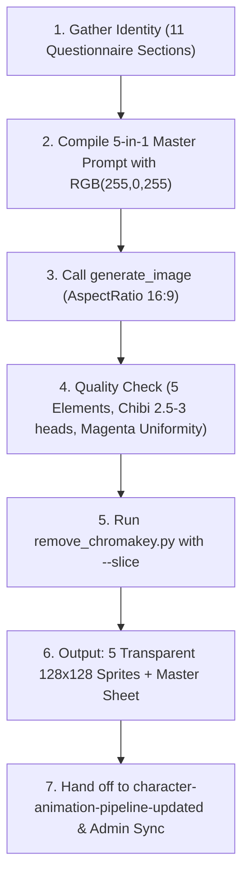

# Character Pipeline Skill (5-in-1 Model Sheet)

## 1. Overview and Purpose

This skill defines the standardized master pipeline for conceiving, prompting, generating, validating, and slicing **5-in-1 character model reference sheets** on a **single image**.

### The 5-in-1 Single Canvas Standard
Instead of generating individual unconnected assets, this pipeline renders **all 5 core character elements together on one 16:9 canvas**:
1. **PORTRAIT**: Close-up face/bust avatar for UI dialogs, HUD portraits, and character selection.
2. **FRONT VIEW**: Full-body character facing forward toward the camera in a battle-ready combat stance.
3. **BACK VIEW**: Full-body character facing directly away, displaying rear armor plates, cloak/cape drape, and back equipment.
4. **RIGHT PROFILE VIEW**: Full-body character in a strict right-facing profile view.
5. **WEAPON PREVIEW**: Isolated, enlarged/detailed display of the character's weapon, tool, or magical focus.

```text
+---------------------------------------------------------------------------------------------------+
|  [1. PORTRAIT]    [2. FRONT VIEW]      [3. BACK VIEW]     [4. RIGHT PROFILE]    [5. WEAPON PREVIEW]|
|   (Bust/Face)       (Full Body)          (Full Body)          (Full Body)           (Isolated)     |
|                                                                                                    |
| <----------------------- Pure Solid Magenta Chromakey RGB(255, 0, 255) -------------------------> |
+---------------------------------------------------------------------------------------------------+
```

### Why a Single Image?
- **Flawless Visual Consistency**: Generating all views in a single prompt guarantees that colors, equipment, metal finishes, scars, costume trim, and chibi proportions are 100% identical across all angles.
- **Resource & Token Efficiency**: One image generation call produces the entire reference package.
- **Direct Turnaround Lock**: Provides the authoritative visual specification directly required by `character-animation-pipeline-updated` (which needs front, back, and right views for 6×4 spritesheets).
- **Automated Slicing**: The bundled python tool key-outs the magenta chromakey and automatically extracts all 5 individual sprites into game-ready 128×128 px assets.

---

## 2. Master Prompt Template (5-in-1 Sheet)

When compiling the generation prompt for the `generate_image` tool, use the following authoritative structure:

```text
16-bit chibi pixel art character concept model sheet and turnaround of a [gender/species/type] [archetype/class], a [role/description].

All 5 elements displayed together on a single reference sheet canvas, cleanly separated with clear spacing between each element, no overlap:
1. PORTRAIT: Close-up face/bust avatar showing sharp facial features and intense expression.
2. FRONT VIEW: Full-body character facing forward toward camera in battle-ready combat stance.
3. BACK VIEW: Full-body character facing directly away, showing detailed rear armor, cloak/cape, and back equipment.
4. RIGHT PROFILE VIEW: Full-body character in strict right-facing profile view.
5. WEAPON PREVIEW: Isolated detailed preview of the character's [weapon/tool/focus] displayed separately.

Chibi proportions with an intentionally oversized head (~30-35% height) and compact body, [body type], [limb description], [stance], consistent scale and grounded baseline across all full-body views, strong readable silhouette.

[Face/head description], [eye description], [expression details], no smile, no cute or adorable expression.

[Hair/head details], [optional mane/markings/ornaments].

[Clothing/armor/body description], [optional accessories], matching equipment, materials, and colors across front, back, and right profile views.

[Held item: Holding a [weapon/tool/focus] with both hands, clearly visible beside the character / Holding no weapon, both hands raised in a ready combat stance], [optional offhand]. Weapon preview displays the standalone [weapon description] in high detail. No other weapons.

[Optional magical/energy effects].

Pure solid magenta chromakey background rgb(255,0,255) #ff00ff, clean 16-bit pixel art game sprite sheet, crisp hard pixel edges, limited color palette, strong contrast, chunky simplified forms, detailed equipment, clear readable silhouette.

Heroic [fantasy/dark fantasy/sci-fi] RPG game character design, battle-ready and dangerous despite chibi proportions.

No anime style, no kawaii style, no cute expression, no childish appearance, no soft pastel colors, [specific exclusions], no realistic proportions, no photorealism, no smooth gradients, no multiple separate canvas files, no text, no view labels, no UI frames.

Additional character details to include: [list all extra details the user specifies].
```

---

## 3. The 11-Part Character Questionnaire

Collect or derive answers for the 11 categories to ensure all 5 views are comprehensively described:

### I. Базовая идентичность (Basic Identity)
1. **Пол, вид или тип персонажа?** (Gender, species, or creature type)
   * *Examples*: `male human`, `female elf`, `genderless skeleton`, `mechanical war-automaton`, `beast wolfman`, `dwarf berserker`
2. **Архетип или класс?** (Archetype or class)
   * *Examples*: `druid`, `warrior`, `mage`, `rogue`, `paladin`, `elementalist`, `necromancer`, `gunner`
3. **Роль или краткое описание?** (Role or brief summary)
   * *Examples*: `deadly nature guardian`, `undead cursed swordsman`, `heavy armored frontline shock trooper`

### II. Тело и поза (Body & Stance)
1. **Телосложение?** (Body build / type)
   * *Examples*: `athletic compact build`, `stocky heavy build`, `skeletal frame`, `bulky reinforced chassis`
2. **Конечности?** (Limb description)
   * *Examples*: `sturdy limbs with chunky iron boots`, `powerful armored gauntlets`, `exposed bleached bone limbs`, `sharp mechanical clawed digits`
3. **Поза?** (Combat stance across views)
   * *Rule*: Identical neutral combat-ready standing pose across FRONT, BACK, and RIGHT profile views.
4. **Акцент на силуэте?** (Silhouette focus)
   * *Default*: `strong readable silhouette with wide shoulder profile and grounded chunky boots, stable baseline across all views`

### III. Лицо и голова (Face & Head — Focus for Portrait & Front View)
1. **Тип лица или головы?** (Face / head type)
   * *Examples*: `weathered human face`, `bare skull with cracked bone`, `faceless iron bucket helmet with narrow slit`, `feral wolf muzzle`, `sleek dark visor`
2. **Глаза?** (Eyes / ocular features)
   * *Examples*: `sharp piercing yellow eyes`, `glowing cyan eye sockets`, `monolithic red visor sensor slit`
3. **Выражение?** (Expression details)
   * *Examples*: `grim focused expression`, `determined stern look`, `cold intimidating stare`, `snarling with bared fangs`
   * *Rule*: `strictly no smile, no cute or adorable expression`
4. **Особые черты лица?** (Unique facial traits)
   * *Examples*: `jagged vertical scar across left eye`, `runic face paint`, `weathered leathery skin`

### IV. Волосы, голова, украшения (Hair, Headgear & Ornaments)
1. **Волосы или головной убор?** (Hair / beard / head covering across all angles)
   * *Examples*: `tied back raven black ponytail`, `thick braided iron-ringed beard`, `bare skull`, `dark velvet hood with frayed edges`
2. **Украшения или детали на голове?** (Head ornaments & markings)
   * *Examples*: `small twisted antler ornaments`, `horned brass helmet crest`, `glowing arcane runes tattooed on temples`

### V. Одежда, броня, тело (Clothing, Armor & Materials across All Angles)
1. **Одежда?** (Clothing / tunic / robes)
   * *Examples*: `tattered moss-green tunic`, `dark layered leather vest`, `torn hooded cloak draping behind`
2. **Броня спереди и со спины?** (Armor pieces front & rear)
   * *Examples*: `forged dark iron breastplate with riveted shoulder pauldrons; back view reveals heavy spinal plating and cloak attachment straps`
3. **Цвета и материалы?** (Color palette & materials)
   * *Examples*: `charcoal dark iron, weathered bronze, moss green, deep earthy brown`
4. **Аксессуары и снаряжение на спине/поясе?** (Accessories, belt, rear gear)
   * *Examples*: `dried herb pouches on front belt; quiver / bedroll / shield harness on back`
5. **Если без одежды?** (If creature / naked beast)
   * *Examples*: `no clothing, thick matted dark fur and armored chitinous plates visible from front, rear, and side`

### VI. Оружие или инструмент (Weapon & Weapon Preview)
1. **Что персонаж держит в руках?** (Main hand weapon / focus)
   * *Examples*: `gnarled oak staff tipped with glowing amber`, `heavy two-handed greatsword`, `twin rune daggers`, `no weapon`
2. **Как держит?** (Grip & posture in full-body views)
   * *Examples*: `Holding a glowing runic staff with both hands, clearly visible beside the character`
3. **Что во второй руке или на оффхенде?** (Offhand item)
   * *Examples*: `spiked buckler shield on left forearm`, `open hand crackling with spark`, `empty raised offhand`
4. **Изолированное превью оружия?** (Weapon Preview specifications)
   * *Rule*: `Weapon preview displays the standalone [weapon description] in high detail, enlarged and clean.`
5. **Отсутствие лишнего оружия?** (Weapon cleanliness)
   * *Mandatory rule*: `No other weapons, no floating secondary swords, no cluttered extraneous back sheath`

### VII. Магия и эффекты (Magic & Effects)
1. **Аура или свечение?** (Aura / glow)
   * *Examples*: `faint emerald magical wisps curling from weapon tip`, `subtle frosty mist at boots`, `no ambient magic`
2. **Частицы?** (Floating particles)
   * *Examples*: `sparse floating amber ember motes`, `subtle purple necrotic smoke wisps`
3. **Ядро или источник силы?** (Energy core / gem)
   * *Examples*: `glowing molten core visible behind ribcage`, `radiant soul crystal in chest`

### VIII. Стиль и палитра (Style, Palette & Chromakey Background)
1. **Палитра?** (Palette properties)
   * *Rule*: `limited 16-bit color palette, strong shadow/highlight contrast, saturated accents, no soft pastel colors`
2. **Стиль спрайта?** (Sprite characteristics)
   * *Rule*: `clean 16-bit pixel art game sprite sheet, crisp hard pixel edges, chunky simplified forms, detailed equipment`
3. **Фон?** (Background chroma key)
   * *Mandatory constraint*: `Pure solid magenta chromakey background rgb(255,0,255) #ff00ff`

### IX. Жанр и настроение (Genre & Mood)
1. **Жанр?** (Setting genre)
   * *Examples*: `dark fantasy`, `high fantasy`, `grim sci-fi / cyberpunk`, `post-apocalyptic`
2. **Общее настроение?** (Tone)
   * *Rule*: `Heroic RPG game character design, battle-ready, serious and dangerous despite chibi proportions`

### X. Негативные требования (Negative Constraints & Exclusions)
1. **Общий обязательный блок негативов**:
   * `No anime style, no kawaii style, no cute expression, no childish appearance, no soft pastel colors, no realistic proportions, no photorealism, no smooth gradients, no multiple separate canvas files, no text, no view labels, no UI frames.`
2. **Специфические исключения под персонажа**:
   * *Examples*: `no flesh or skin on skeleton`, `no puppy eyes or cute dog face on werewolf`, `no modern sneakers`, `no angel wings`, `no elf ears`

### XI. Дополнительные детали (Additional Details)
1. **Уникальные акценты**:
   * *Examples*: `notched battle blade with blood groove, golden skull medallion pinned to chest, bandaged forearms`

---

## 4. Execution Workflow



### Step 1: Gather Parameters
Collect answers to the 11 sections. If the user provided a brief description, extrapolate logical values maintaining the dark fantasy heroic art direction.

### Step 2: Compile the 5-in-1 Prompt
Assemble using the **Master Prompt Template** in Section 2, ensuring all 5 parts (Portrait, Front, Back, Right Profile, Weapon Preview) are listed.

### Step 3: Call Image Generation Tool
Call `generate_image` with:
- `Prompt`: The compiled 5-in-1 prompt.
- `ImageName`: `hero_<character_name>_sheet` (e.g. `hero_deathknight_sheet`).
- `AspectRatio`: `'16:9'` (ensures horizontal room for all 5 elements side-by-side).

### Step 4: Quality Gate
Verify the generated image:
1. **Completeness**: Contains all 5 elements: Portrait, Front, Back, Right Profile, and Weapon Preview.
2. **Proportions**: Strict 2.5–3 heads tall chibi anatomy across the 3 full-body views.
3. **Expression**: Cold, serious, grim. Zero kawaii or cute smile.
4. **Chromakey**: Pure solid magenta `#FF00FF` background without color ramps or text labels.

### Step 5: Automated Chroma Key Removal & Slicing
Run the pipeline script with `--slice`:

```powershell
python .agents/skills/character-pipeline/scripts/remove_chromakey.py `
  -i "<path_to_generated_image.png>" `
  -o "public/textures/heroes/hero_<name>_sheet.png" `
  --slice `
  -d "public/textures/heroes" `
  -p "hero_<name>"
```

This single command automatically generates:
- `hero_<name>_sheet.png`: Full transparent 16:9 master model sheet.
- `hero_<name>_portrait.png`: 128×128 px transparent close-up portrait for UI/HUD.
- `hero_<name>_front.png`: 128×128 px transparent front full-body sprite.
- `hero_<name>_back.png`: 128×128 px transparent back full-body sprite.
- `hero_<name>_right.png`: 128×128 px transparent right profile sprite.
- `hero_<name>_weapon.png`: 128×128 px transparent isolated weapon sprite.

---

## 5. Concrete Prompt Examples

### Example A: Undead Skeleton Death Knight
```text
16-bit chibi pixel art character concept model sheet and turnaround of a genderless skeleton Death Knight, a cursed heavy armored undead vanguard.

All 5 elements displayed together on a single reference sheet canvas, cleanly separated with clear spacing between each element, no overlap:
1. PORTRAIT: Close-up face/bust avatar showing sharp cracked skull features, glowing ice-blue eye sockets, and rusted crown.
2. FRONT VIEW: Full-body character facing forward toward camera in battle-ready combat stance with two-handed greatsword.
3. BACK VIEW: Full-body character facing directly away, showing heavy spine armor plates, tattered black cape, and scabbard straps.
4. RIGHT PROFILE VIEW: Full-body character in strict right-facing profile view showing side helm crest and armor profile.
5. WEAPON PREVIEW: Isolated detailed preview of the massive jagged runic two-handed greatsword displayed separately.

Chibi proportions with an intentionally oversized head (~30-35% height) and compact body, skeletal frame with bulky armor, bone limbs with heavy iron greaves and gauntlets, matching ground baseline across all full-body views, strong readable silhouette.

Cracked aged skull, glowing ice-blue eye sockets, grim cold intimidating stare, no smile, no cute or adorable expression.

No hair, bare skull adorned with a rusted jagged iron crown, glowing frosted bone markings.

Tattered blackened tabard over rusted dark iron plate armor, chipped bone pauldrons on shoulders, heavy steel gorget, consistent equipment and colors across front, back, and right views.

Holding a massive jagged two-handed runic greatsword with both hands, clearly visible beside the character, frost wisps on the blade. Weapon preview displays the standalone frost greatsword in high detail. No other weapons.

Subtle chilling frost mist particles around feet and sword tip, glowing blue soul fire in ribcage.

Pure solid magenta chromakey background rgb(255,0,255) #ff00ff, clean 16-bit pixel art game sprite sheet, crisp hard pixel edges, limited color palette, strong contrast, chunky simplified forms, detailed equipment, clear readable silhouette.

Heroic dark fantasy RPG game character design, battle-ready and dangerous despite chibi proportions.

No anime style, no kawaii style, no cute expression, no childish appearance, no soft pastel colors, no flesh, no skin, no friendly skull, no realistic proportions, no photorealism, no smooth gradients, no multiple separate canvas files, no text, no view labels, no UI frames.

Additional character details to include: jagged runes carved into iron armor, chipped blade edges, iron chain belt with hung skull trinket.
```

### Example B: Forest Beast Shaman / Druid
```text
16-bit chibi pixel art character concept model sheet and turnaround of a male beastkin Druid Shaman, a deadly ancient forest guardian.

All 5 elements displayed together on a single reference sheet canvas, cleanly separated with clear spacing between each element, no overlap:
1. PORTRAIT: Close-up face/bust avatar showing feral horned wolf features, glowing amber eyes, and bared fangs.
2. FRONT VIEW: Full-body character facing forward toward camera in low aggressive combat stance holding runic staff.
3. BACK VIEW: Full-body character facing directly away, showing thick wolf mane, rear leather straps, and herb satchel harness.
4. RIGHT PROFILE VIEW: Full-body character in strict right-facing profile view showing arched back, muzzle profile, and tail.
5. WEAPON PREVIEW: Isolated detailed preview of the gnarled oak staff topped with an emerald spirit crystal displayed separately.

Chibi proportions with an intentionally oversized head (~30-35% height) and compact body, muscular stocky build, thick fur limbs with clawed leather gauntlets and chunky hide boots, matching ground baseline across all full-body views, strong readable silhouette.

Feral horned wolf face, sharp glowing amber eyes, snarling focused grim gaze with bared fangs, no smile, no cute or adorable expression.

Thick dark timber-wolf mane around neck, small twisted antler horns sprouting from temples, braided beard with iron rings.

Tattered moss-green tunic, reinforced cured brown leather shoulder armor, bronze bracers, runic herb pouches on hip belt, consistent colors across all views.

Holding a gnarled oak staff topped with an emerald spirit crystal with both hands, clearly visible beside the character. Weapon preview displays the standalone oak spirit staff in high detail. No other weapons.

Faint magical emerald green aura wisps around staff crystal, floating spore particles.

Pure solid magenta chromakey background rgb(255,0,255) #ff00ff, clean 16-bit pixel art game sprite sheet, crisp hard pixel edges, limited color palette, strong contrast, chunky simplified forms, detailed equipment, clear readable silhouette.

Heroic dark fantasy RPG game character design, battle-ready and dangerous despite chibi proportions.

No anime style, no kawaii style, no cute expression, no childish appearance, no soft pastel colors, no puppy face, no fluffy cartoon animal, no slender human body, no realistic proportions, no photorealism, no smooth gradients, no multiple separate canvas files, no text, no view labels, no UI frames.

Additional character details to include: runic tattoos painted in pale clay on forearms, feather charms tied to staff horns.
```

### Example C: Tech Mech Paladin (Grim Sci-Fi)
```text
16-bit chibi pixel art character concept model sheet and turnaround of a genderless combat automaton Tech Paladin, a heavy armored shock assault unit.

All 5 elements displayed together on a single reference sheet canvas, cleanly separated with clear spacing between each element, no overlap:
1. PORTRAIT: Close-up face/bust avatar showing angular blast helmet, glowing crimson sensor slit, and cranial plates.
2. FRONT VIEW: Full-body character facing forward toward camera in firm grounded combat stance holding kinetic warhammer.
3. BACK VIEW: Full-body character facing directly away, showing heavy thermal exhaust vents, spine conduit cables, and rear battery pack.
4. RIGHT PROFILE VIEW: Full-body character in strict right-facing profile view showing hydraulic knee joints and weapon grip.
5. WEAPON PREVIEW: Isolated detailed preview of the heavy kinetic warhammer with energized copper coils displayed separately.

Chibi proportions with an intentionally oversized head (~30-35% height) and compact body, bulky armored industrial chassis, heavy hydraulic limbs with reinforced armored gauntlets and magnetic clamp boots, matching ground baseline across all full-body views, strong readable silhouette.

Reinforced blast helmet, glowing crimson horizontal sensor slit, stern menacing robotic glare, no smile, no cute or adorable expression.

No hair, crowned with angular communication antenna and reinforced cranial blast plates.

Heavy gunmetal grey ceramic armor plating with hazard orange trim, energy conduit cables running across chest and limbs, consistent materials across front, back, and right views.

Holding a heavy kinetic warhammer with both hands, clearly visible beside the character. Weapon preview displays the standalone kinetic warhammer in high detail. No other weapons.

Subtle electric spark particles on hammer head, glowing power reactor vent in torso center.

Pure solid magenta chromakey background rgb(255,0,255) #ff00ff, clean 16-bit pixel art game sprite sheet, crisp hard pixel edges, limited color palette, strong contrast, chunky simplified forms, detailed equipment, clear readable silhouette.

Heroic sci-fi RPG game character design, battle-ready and dangerous despite chibi proportions.

No anime style, no kawaii style, no cute expression, no childish appearance, no soft pastel colors, no organic skin, no friendly robot eyes, no realistic proportions, no photorealism, no smooth gradients, no multiple separate canvas files, no text, no view labels, no UI frames.

Additional character details to include: unit designation stencil "UNIT-07" on right pauldron, exhaust vent seams on shoulders.
```

---

## 6. Downstream Integration & Pipeline Handover

1. **Character Animation**:
   The extracted `hero_<name>_front.png`, `hero_<name>_back.png`, and `hero_<name>_right.png` provide the exact turnaround reference needed for `.agents/skills/character-animation-pipeline-updated/SKILL.md` to produce the full 6×4 animation sheets (`IDLE`, `WALK`, `ATTACK`).
2. **UI & HUD**:
   The extracted `hero_<name>_portrait.png` directly integrates into the game's UI and dialog modules (`game/src/ui/modules/HeroUIHelpers.ts` and HUD character select).
3. **Weapon & Inventory**:
   The extracted `hero_<name>_weapon.png` serves as the icon/texture for inventory slots and admin panel simulator preview.
4. **Balance & Admin Registration**:
   Follow `.agents/rules/entity-admin-sync.md` to register the new hero and weapon in:
   - `game/src/balance/defaultBalance.ts`
   - `admin/src/constants.ts`
