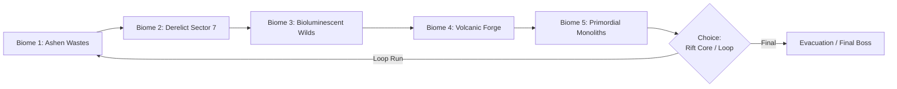
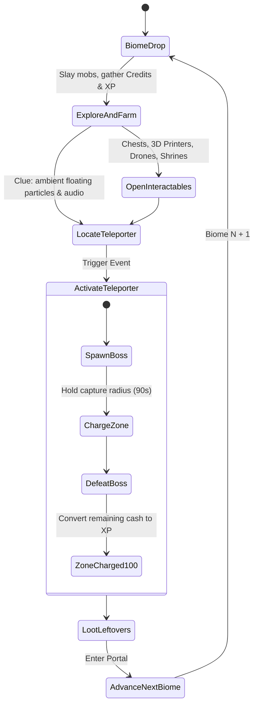
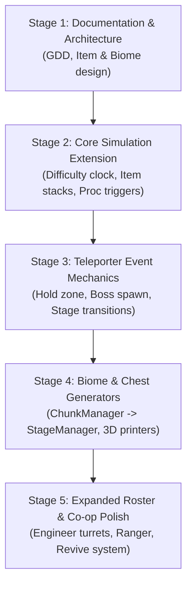

# Game Design Document: The Rift

> **Genre:** 2.5D Top-Down Action Roguelike / Sci-Fi Co-op Survival  
> **Inspiration:** *Risk of Rain 2*, *Vampire Survivors*, *Enter the Gungeon*  
> **Camera:** Fixed Isometric / Top-Down  
> **Combat System:** WASD Movement + Smart Auto-aim & Auto-fire + Active Class Skills / Gadgets  
> **Multiplayer:** Single-player + Co-op up to 5 players (P2P WebRTC / Dedicated headless server)

---

## 1. Project Concept & Vision

### 1.1. Core Pitch
**"The Rift"** is a fast-paced sci-fi cooperative top-down roguelike where the core gameplay loop is inspired by **Risk of Rain 2**, streamlined for lightning-fast arcade isometric action with smart auto-firing weapons.

Players take on the roles of surviving crew members of a research vessel that crash-landed on the hostile alien planet **Aethelgard (Nexus-IV)**. The world is fractured by spatial and gravitational rifts ("Rifts") that continuously spawn waves of mutated horrors and ancient battle automata.

The primary run objective is to fight through deadlier biomes, accumulating items and explosive synergies, defeat the Teleporter Guardians, and reach the Rift Core to activate an evacuation dropship or seal the anomaly permanently.

### 1.2. Design Pillars

```
┌────────────────────────────────────────────────────────────────────────┐
│                        "THE RIFT" DESIGN PILLARS                       │
├──────────────────┬──────────────────┬──────────────────┬───────────────┤
│ 1. TIME IS ENEMY │ 2. SYNERGIES &   │ 3. HIGH TEMPO &  │ 4. CO-OP &    │
│                  │    POWER SCALING │    MOVEMENT      │    SYNCHRONY  │
├──────────────────┼──────────────────┼──────────────────┼───────────────┤
│ The longer the   │ Items stack      │ Smart auto-fire  │ Up to 5       │
│ run, the fiercer │ infinitely; proc │ eliminates aim   │ players, role │
│ the hordes.      │ chains turn      │ grind; focus on  │ synergies,    │
│ Balance looting  │ players into     │ positioning and  │ team shrines, │
│ against clock.   │ war machines.    │ dodging.         │ shared chaos. │
└──────────────────┴──────────────────┴──────────────────┴───────────────┘
```

1. **Time is Your Chief Enemy (Time Scaling):**  
   Every minute, the difficulty gauge advances. Enemies gain health, speed, and damage, and dangerous elite monsters with affixes emerge. Players face a constant trade-off: spend an extra 2 minutes looting a distant gold chest or charge the Teleporter before difficulty surges out of control.
2. **Item Stacking & Proc Chains:**  
   Items are passive and stack infinitely. A hit applies bleed $\to$ a crit triggers a plasma explosion $\to$ the explosion arcs chain lightning $\to$ lightning triggers lifesteal. Build crafting opens vast emergent synergy potential.
3. **Smart Auto-Aim and Movement Mastery (Bullet-Hell & Positioning):**  
   Players do not need to micro-aim with a crosshair in 3D space. Weapons automatically acquire the closest high-threat targets, prioritizing elites and bosses, freeing the player to master positioning, kiting large swarms, timing dashes, and deploying class skills.
4. **Fluid 1–5 Player Cooperative Play:**  
   Synchronization through the modular `GameCore` simulation core (on host client or dedicated server), shared Teleporter charging events, revives for fallen allies upon stage completion, and coordinated team combos.

---

## 2. Setting and Biomes

The planet **Aethelgard** was fragmented into disparate sectors by an ancient cataclysm. Each run features procedural traversals through distinctive biomes.



### 2.1. Biome Breakdown

| Biome | Visual Aesthetic | Unique Hazards & Interactivity | Enemy Types & Elites |
| :--- | :--- | :--- | :--- |
| **1. Ashen Wastes** | Rust sand, dunes, crashed drop pods, colossal creature skeletons | Sand vortices, geothermal vents providing jump boosts | Burrower beetles, scavenging drones, Mud Golem |
| **2. Derelict Sector 7** | Ruined research labs, neon terminals, ruptured conduits | Laser grids, toxic coolant spills, defense turrets | Defective combat androids, hovering sentry turrets, Assault Servitor |
| **3. Bioluminescent Wilds** | Deep purple-green alien forest, luminescent fungi, spore fog | Exploding spore pods, glowing rejuvenation pools | Spitting tox-fungi, multi-legged stalkers, Spore Matron |
| **4. Volcanic Forge** | Black obsidian, lava flows, molten alloy, plasma vents | Molten magma channels (ticking damage upon contact), ash storms | Magma wyverns, flame elementals, Magma Colossus |
| **5. Primordial Monoliths** | Floating golden monoliths, antigravity platforms, ancient glyphs | Gravity wells, repulsor launch pads | Titan Stoneguard, kinetic prisms, Rift Guardian |
| **6. The Rift Core (Finale)** | Spatial anomaly storm, inverted physics, fractured debris, dropship pad | Antimatter bursts, collapsing arena rings | Final Boss: **"Rift Architect"** + 2:00 shuttle escape countdown |

---

## 3. Core Gameplay Loop

The loop combines Risk of Rain 2 structure with arcade survival combat:



### 3.1. Stage Phases
1. **Drop In:**  
   Players spawn by the drop capsule. The timer starts at `00:00`.
2. **Farming & Economy (Plasma Credits):**  
   - Defeating mobs yields **Credits** (stage currency) and **XP** (character level).  
   - Credits purchase chests of various tiers, repair fallen drones, and activate shrines.  
   - *Crucial rule:* Credits do not carry over across stages! Upon Teleporter completion, leftover funds convert directly into bonus character XP.
3. **Locating & Activating the Teleporter:**  
   - An ancient Teleporter is hidden within the biome. Sparkling rift sparks drift through the air around it to guide players.  
   - Activating initiates the **Teleporter Event**:
     - A charging radius (~35–40m) forms around the pedestal.
     - A stage **Boss** spawns (or elite boss packs at higher difficulties).
     - A 90-second countdown runs whenever at least one living player stands inside the ring.
4. **Stage Clear & Transition:**  
   - At 100% charge with the Boss defeated, the combat music subsides and ambient spawns cease.  
   - The unique Boss Trophy Chest drops.  
   - Players have a brief window to spend converted currency across remaining chests before stepping through the gate to the next sector.

---

## 4. Control Scheme and Camera

### 4.1. Camera
- **Perspective:** Fixed 2.5D isometric view tilted 50–60° from the horizontal plane.
- **Smooth Lerp:** Follows the character with gentle velocity lookahead. In multiplayer, camera supports dynamic zoom framing or per-player viewport rendering.

### 4.2. Controls
- **WASD / Left Stick:** Character movement in all directions.
- **Auto-Aim & Auto-Fire:**  
   Weapons continuously engage targets within range without manual clicking.  
   *Targeting Priority:*
   1. Closest immediate threats within strike range.
   2. Elite foes with deadly affixes.
   3. Stage bosses.
- **Space / Shift (Utility - Mobility):**  
   Tactical Dash / Roll with invulnerability frames (0.22–0.25s) and gap traversal over hazard pools.
- **Q / E Keys (Special - Class Abilities):**  
   Unique active abilities (turret deployment, cryo grenade, plasma burst).
- **R Key (Equipment - Relic):**  
   Long-cooldown activatable artifact (Orbital Strike, Chest Radar, Kinetic Bubble).
- **E / F Keys (Interact):**  
   Open chests, engage 3D printers, activate teleporters.

---

## 5. Dynamic Difficulty: The Time Director

Difficulty escalates every second. There are no pauses; every elapsed minute ramps up challenge.

```
[0:00 - 3:00]   EASY           (Basic enemies, modest spawn rate)
[3:00 - 6:00]   MEDIUM         (Elevated enemy health, basic packs)
[6:00 - 9:00]   HARD           (First elite spawns emerge)
[9:00 - 13:00]  INSANE         (Massive swarms, aggressive behaviors)
[13:00 - 18:00] IMPOSSIBLE     (Multiple elites, severe damage)
[18:00 - 25:00] I SEE YOU      (Extreme chaos, bosses spawn as standard mobs)
[25:00+]        APOCALYPSE     (Survival ceiling: only god-tier builds endure)
```

### 5.1. Director Scaling Formulas
Every tick, the spawn director receives Spawn Credits based on:
$$DifficultyCoefficient = (1 + 0.05 \cdot t_{min}) \cdot (1 + 0.3 \cdot (Players - 1)) \cdot 1.15^{Stage - 1}$$
- Monster Health: $HP = HP_{base} \cdot DifficultyCoefficient^{1.1}$
- Monster Damage: $DMG = DMG_{base} \cdot (1 + 0.15 \cdot DifficultyCoefficient)$
- Chest opening costs also scale over time, maintaining economic momentum.

### 5.2. Elite Affixes
Elite enemies feature radiant visual auras and potent passive properties:
1. **Blazing (Red Aura):** Leaves damaging fire trails; attacks ignite players.
2. **Overloading (Electric Blue):** Possesses 50% max HP as energy shields; attacks lodge delayed lightning bomblets.
3. **Glacial (Ice Cyan):** Chills on hit; detonates in a cryogenic nova 1.5 seconds after death.
4. **Malachite (Dark Emerald Spikes):** Fires tracking thorn darts; aura nullifies all player healing and regeneration for 5 seconds.
5. **Void / Shadow:** Periodically phase-shifts through incoming player projectiles.

---

## 6. Items, Synergies, and Economy

In "The Rift", player power relies heavily on accumulated passive items. Items are organized into rarity tiers and support unlimited stacking.

```
┌─────────────────────────────────────────────────────────────┐
│                    ITEM TIERS IN THE RIFT                   │
├─────────────────┬─────────────────┬─────────────────────────┤
│ Rarity          │ Color           │ Build Role              │
├─────────────────┼─────────────────┼─────────────────────────┤
│ Common (White)  │ White / Slate   │ Stat foundation & proc  │
│ Uncommon (Green)│ Neon Green      │ Synergies & AOE bursts  │
│ Legendary (Red) │ Crimson Red     │ Game-changing capstones │
│ Boss (Yellow)   │ Radiant Gold    │ Unique boss drop relics │
│ Corrupted (Purp)│ Violet          │ High risk / mutations   │
│ Equipment (Oran)│ Amber Orange    │ Active abilities ('R')  │
└─────────────────┴─────────────────┴─────────────────────────┘
```

### 6.1. Item Highlights

#### Common (White) — Build Foundation:
- **Kinetic Injector:** +15% weapon attack speed (+15% per stack).
- **Nanite Plating:** Diminishing returns damage reduction (5% at level 1 up to 60% cap at level 20).
- **Adrenaline Dart:** +12% movement speed (+12% per stack).
- **Pulse Rounds:** 15% chance to inflict bleed dealing 180% damage over 3 seconds.
- **Bio-Injector (Health Vial):** +2.5 HP/s passive regeneration (+2.5 per stack).

#### Uncommon (Green) — Synergies & Scaling:
- **Chain Lightning Coil:** 25% chance to fire chain lightning across 3 targets (+2 per stack) for 160% damage.
- **Plasma Core:** Defeating an enemy causes a 4m radius explosion for 200% base damage.
- **Crit Visor:** +12% critical strike chance (+12% per stack). Critical hits deal 200% damage.
- **Aegis Battery:** Generates an energy shield with +35 max HP capacity (+35 per stack), recharges out of combat.
- **Bio-Leech:** Restores +5 HP per monster defeated.

#### Legendary (Red) — Build Capstones:
- **Singularity Core:** Every 10th kill spawns a gravitational vortex pulling enemies within 12m and detonating for 600% damage.
- **Orbital Strike Protocol:** Every 12 seconds, an orbital cannon obliterates the highest-health target in range for 800% damage.
- **Chronos Phylactery:** On lethal damage, freezes all entities for 5s, repels enemies 25m, and restores 50% HP (once per stage).
- **Resonance Amplifier:** All damage-over-time effects tick twice as fast and can critically strike.

#### Boss Items (Yellow):
- **Golem Core:** Periodically fires a kinetic beam stunning foes for 2 seconds.
- **Molten Scale:** Leaves a trail of scorched ground burning pursuers proportional to movement speed.

#### Corrupted Relics (Purple):
- Mutate existing items. Example: transforms all "Crit Visors" into "Void Visors" — critical strike chance drops to 0, but all strikes gain a 1% chance to instantly disintegrate non-boss enemies.

### 6.2. Interactive Map Stations
1. **3D Printers (Item Fabricators):** Trade a random item of matching rarity to produce a copy of the displayed item.
2. **Scrappers:** Convert unwanted items into neutral Scrap, which printers consume before taking active items!
3. **Shrines:**
   - *Shrine of Chance:* Pay credits for a chance to win items (or fail).
   - *Shrine of the Combat:* Instantly summons 2 elite monsters; awards a chest upon victory.
   - *Shrine of Blood:* Trade 50% current HP for an immediate payout of credits.

---

## 7. Survivor Classes

Each hero features a distinct combat philosophy, primary weapon, and utility abilities:

```
┌────────────────────────────────────────────────────────────────────────┐
│                        RIFT SURVIVOR ROSTER                            │
├──────────────────┬──────────────────┬──────────────────┬───────────────┤
│ 1. SCOUT         │ 2. JUGGERNAUT    │ 3. ENGINEER      │ 4. MYSTIC     │
│    (Commando)    │    (Enforcer)    │    (Engineer)    │    (Artificer)│
├──────────────────┼──────────────────┼──────────────────┼───────────────┤
│ - Dual blasters  │ - Plasma shotgun │ - Rifle + 2      │ - Tri-element │
│ - High agility   │ - Kinetic shield │   turrets with   │ - Phase shift │
│ - Cluster        │ - Ground slam    │   full item copy │ - Singularity │
│   grenade        │ - Massive HP     │ - Spider mines   │ - Arc bursts  │
└──────────────────┴──────────────────┴──────────────────┴───────────────┘
```

1. **The Scout (Commando):**  
   - *Weapon:* Dual pulse blasters (high fire rate, optimal for proc chains).  
   - *Utility (Shift):* Tactical roll with dodge frames.  
   - *Special (Q):* Nano-fragmentation cluster grenade.
2. **The Juggernaut (Enforcer):**  
   - *Weapon:* Heavy plasma shotgun (close-range cone blast, heavy knockback).  
   - *Utility (Shift):* Shield tackle knocking foes back.  
   - *Special (Q):* Deployed energy barrier blocking frontal projectiles.
3. **The Engineer:**  
   - *Weapon:* Flechette carbine with micro-homing darts.  
   - *Utility (Shift):* Shield bubble regenerating ally shields inside.  
   - *Special (Q):* Deployable automated Gauss turrets (up to 2). **Core feature: turrets inherit 100% of the engineer's items!**
4. **The Mystic (Artificer):**  
   - *Weapon:* Cycling plasma bolts of fire, ice, and lightning.  
   - *Utility (Shift):* Phase shift (temporary energy flight phasing through enemies).  
   - *Special (Q):* Charged vortex freezing and pulling enemies inward.
5. **The Ranger:**  
   - *Weapon:* Piercing railgun (massive damage per shot, penetrates lines of enemies).  
   - *Utility (Shift):* Spatial blink.  
   - *Special (Q):* Spotter drone highlighting enemy weak spots (+100% damage to targets).

---

## 8. Cooperative Multiplayer (Up to 5 Players)

Co-op supports shared progression for up to 5 players via WebRTC P2P or headless dedicated server.

### 8.1. Co-op Dynamic Scaling
- **Enemy Health:** $+35\%$ per additional player in session.
- **Chest Density:** Scaled proportionally so all teammates build robust loadouts.
- **Teleporter Radius:** Charge progress accelerates with multiple allies standing within the boundary.

### 8.2. Revive & Spectate Mechanics
- When a player's health reaches 0, they enter a Downed state. Allies can revive them within 20 seconds.
- If the countdown expires without revival, the player transitions to Spectator mode.
- **Resurrection:** All fallen teammates automatically revive at full health upon successful charge and clearance of the current stage Teleporter!

---

## 9. Technical Architecture Integration

The project employs a clean modular structure:
- **Headless Simulation (`src/sim/GameCore.ts`):** All monster logic, timers, collisions, and damage calculations run independently of Three.js.
- **Presentation Layer (`src/core/Engine.ts`, `entities/`):** 2.5D rendering, particle visual effects, shader materials.
- **Networking Stack (`src/net/`, `server/dedicatedServer.ts`):** Snapshot serialization and connection management.

### Implementation Roadmap



1. **Stage 1 (Current):** Align design document specifications for "The Rift" and lock core mechanics.
2. **Stage 2 (Simulation Core):** Integrate global difficulty scaling clock, stacked item data structures, and the proc dispatch engine into `GameCore`.
3. **Stage 3 (Teleporter Mechanics):** Implement `Teleporter` entity with 90s capture logic, stage boss encounters, and end-of-stage currency conversion.
4. **Stage 4 (World & Biomes):** Transition procedural generation from endless open chunks into delimited biome maps (Desert, Tech, Forest, Volcano, Ruins) with key landmarks.
5. **Stage 5 (Polish & Networking):** Add rift particle shaders, audio cues, network snapshot sync for teleporter states, and ally revival flows.
